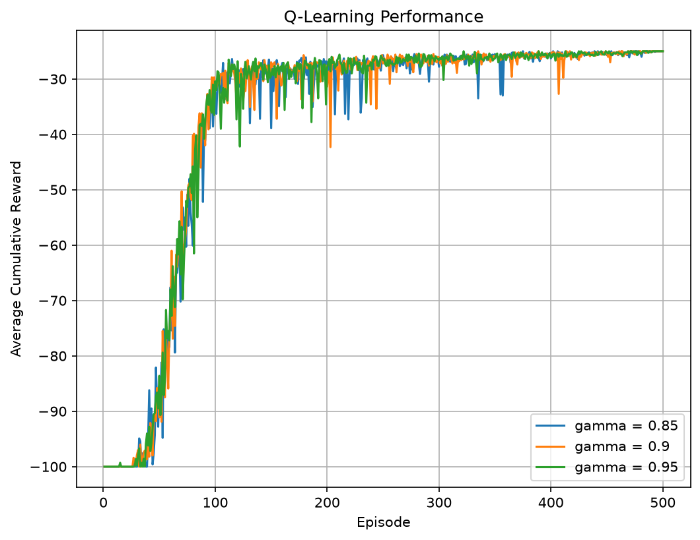
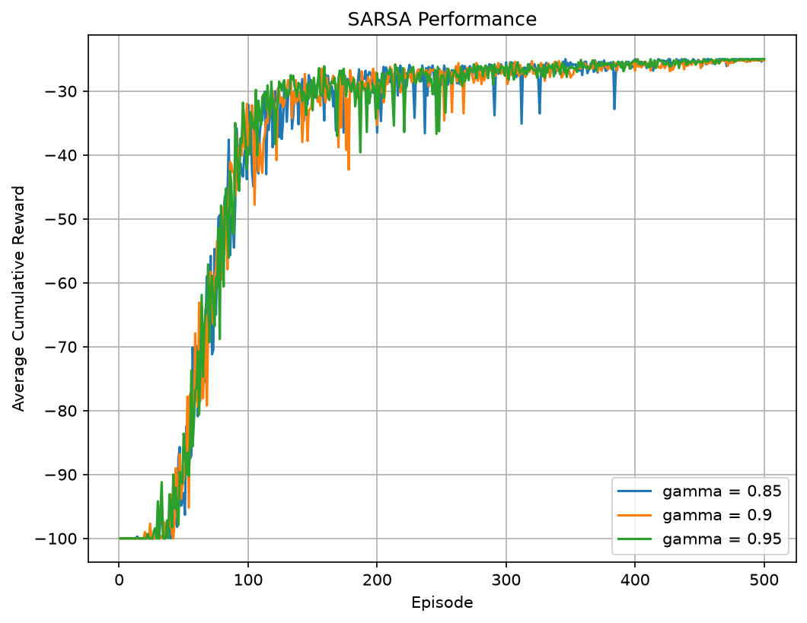
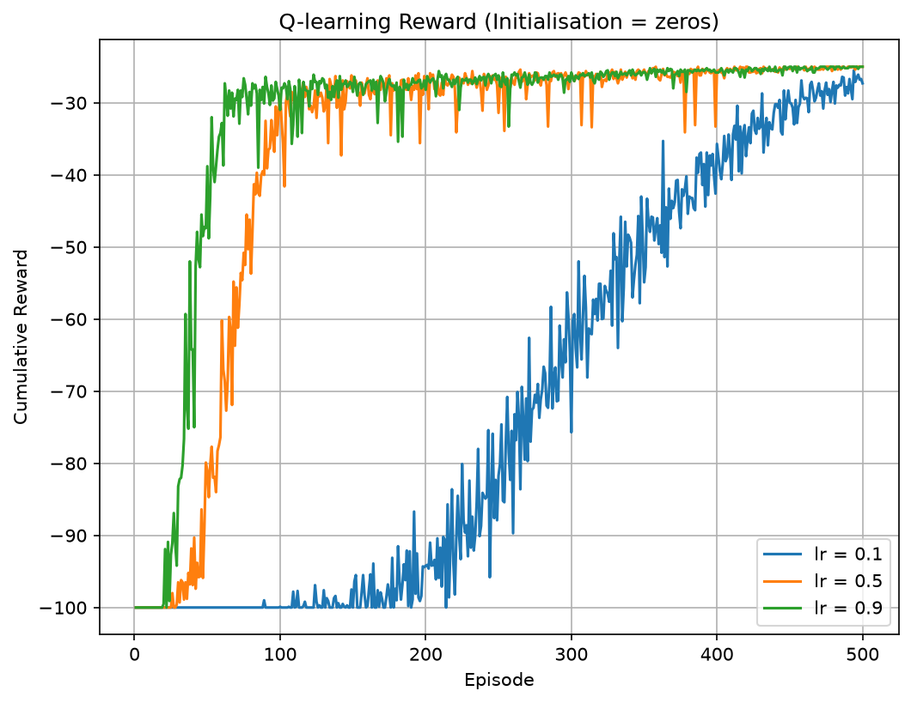
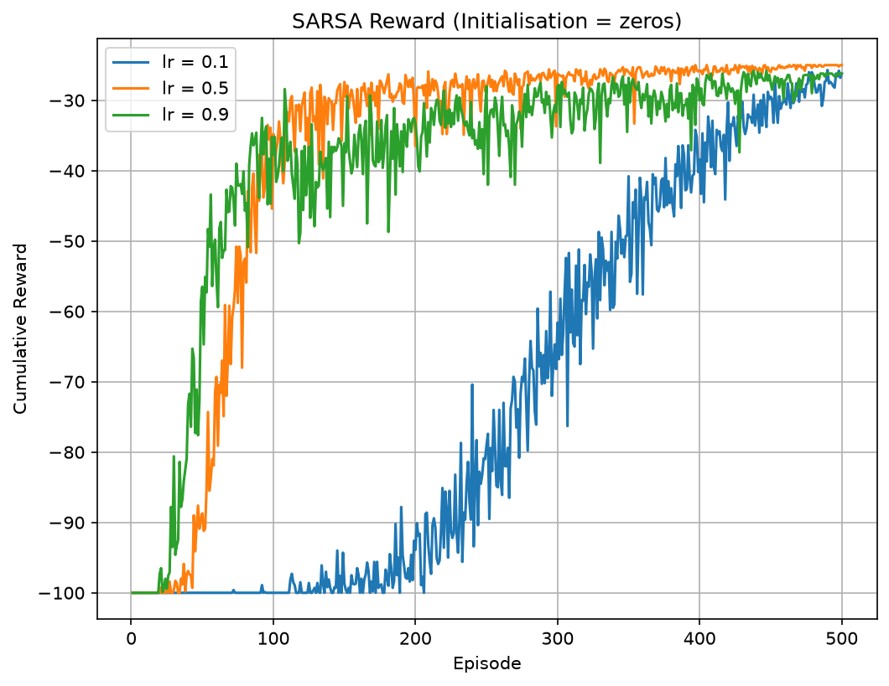

# RL Fundamentals: Q-learning vs SARSA in a Grid Maze

Tabular reinforcement learning implemented from scratch with NumPy. A robot learns to navigate a 10×10 maze using **Q-learning** (off-policy) and **SARSA** (on-policy), and the two methods are compared under different discount factors and learning rates.

## Environment

The maze comes from [DungeonMazeWorld](https://github.com/uobcll/SEMTM0016_DungeonMazeWorld), a Gymnasium environment included here as a git submodule.

| | |
|---|---|
| **State** | Robot position (x, y) and heading (up / right / down / left): 10 × 10 × 4 = 400 states |
| **Actions** | 0 turn right, 1 turn left, 2 move forward |
| **Reward** | −1 per step |
| **Episode** | Starts at (1, 1) facing down, ends at the goal (8, 8) or after 100 steps |
| **Maze** | Fixed with `seed=124`, so every episode uses the same layout |

## Algorithms

Both methods keep a Q table of shape `(10, 10, 4, 3)` and choose actions with ε-greedy exploration (ε decays linearly from 0.1 to 0). They differ only in the TD target:

| Method | Update target | Type |
|---|---|---|
| **Q-learning** | r + γ · max<sub>a'</sub> Q(s', a') | Off-policy: learns the value of the best possible policy |
| **SARSA** | r + γ · Q(s', a'), where a' is the action actually taken next | On-policy: learns the value of the policy it is following, exploration included |

Both use the same update rule:

```
Q(s, a) ← Q(s, a) + α · [ target − Q(s, a) ]
```

### Reward design: fixing a reward-hacking issue

The original environment gives **0** reward for bumping into a wall and **−1** for every other action. Under this reward, "bump into a wall forever" earns a return of 0, which beats any path to the goal. The agent learned exactly that and never reached the goal.

Treating a wall bump as a normal −1 step makes the shortest path the optimal policy.

## Results

Default settings: γ = 0.99, α = 0.5, 500 episodes, averaged over 10 independent runs.

- Both Q-learning and SARSA converge to an average return of about −25, which matches the **25-step shortest path** through the maze.
- **γ barely matters here.** Every step costs −1, so fewer steps always means a higher return for any γ, and all values of γ lead to the same optimal path.
- **The learning rate matters most.** With α = 0.1, learning is far slower than with α = 0.5 or 0.9, because the environment is deterministic and every sample can be trusted.
- **SARSA is noisier with a large learning rate.** With α = 0.9, SARSA's curve is much noisier than Q-learning's, because its target depends on the randomly explored next action.

| Q-learning | SARSA |
|---|---|
|  |  |
|  |  |

## Project structure

```
RL_Fundamentals/
├── src/rl_fundamentals/
│   ├── utils.py            # Environment import, state conversion, ε-greedy
│   ├── q_learning.py       # Q-learning algorithm
│   └── sarsa.py            # SARSA algorithm
├── scripts/
│   ├── train_q_learning.py # Run experiments, save plots and the trained Q table
│   ├── train_sarsa.py
│   ├── watch_q_learning.py # Load the Q table and watch the agent in a pygame window
│   └── watch_sarsa.py
├── plots/                  # Training curves
└── third_party/
    └── DungeonMazeWorld/   # Environment (git submodule)
```

## Getting started

Requires Python 3.12+ and [uv](https://docs.astral.sh/uv/).

```bash
git clone --recurse-submodules https://github.com/JimCH123/RL_Fundamentals
cd RL_Fundamentals
uv sync
```

Train an agent. This runs the γ and learning-rate experiments, saves the plots to `plots/` and saves the Q table to `results/`:

```bash
uv run python scripts/train_q_learning.py
uv run python scripts/train_sarsa.py
```

Each plot opens in a window; close it to continue.

Watch the trained agent walk the maze:

```bash
uv run python scripts/watch_q_learning.py
uv run python scripts/watch_sarsa.py
```

## Acknowledgements

The maze environment is [DungeonMazeWorld](https://github.com/uobcll/SEMTM0016_DungeonMazeWorld) (Apache-2.0 License).